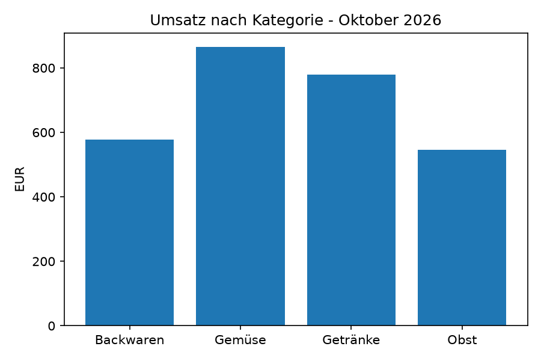

# Monthly Sales Report Generator

A small Python tool that reads a sales Excel file and automatically creates a one-page **German PDF report** (*Monatsbericht*) with a chart and tables.

## What it does

- Reads sales data from an Excel file
- Calculates total revenue, revenue per category and the top 3 articles
- Creates a bar chart
- Writes a PDF report in German

## Example output



See the full example report: [Monatsbericht_Oktober_2026.pdf](Monatsbericht_Oktober_2026.pdf)

## How to use

1. Install Python 3 and the required libraries:

   ```
   pip install openpyxl matplotlib fpdf2
   ```

2. Put your Excel file in the same folder.
3. Open `monatsbericht.py` and change the two lines at the top (`input_file` and `report_title`).
4. Run:

   ```
   python monatsbericht.py
   ```

## Input format

The Excel file needs these columns, in this order:

`Datum | Kategorie | Artikel | Menge | Preis`

The included file `oktober_daten.xlsx` contains **synthetic sample data** (no real customer data).

## Customization

Every business keeps its data a little differently. The tool can be adapted to your own Excel file format.

## Tech

Python, openpyxl, matplotlib, fpdf2

---

## Auf Deutsch

Ein kleines Python-Programm, das aus einer Excel-Verkaufsdatei automatisch einen einseitigen **Monatsbericht als PDF** erstellt: mit Gesamtumsatz, Umsatz je Kategorie, Top-3-Artikeln und einem Diagramm. Die Beispieldaten sind frei erfunden.
